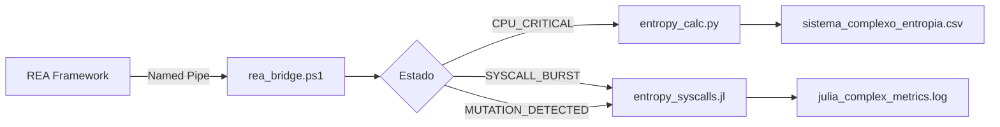

# Pipeline Completo — Terminal-Laboratório

## 🎯 Visão Geral do Pipeline

```
┌─────────────┐     ┌─────────────┐     ┌─────────────┐     ┌─────────────┐
│   COLETA    │────▶│  ANÁLISE    │────▶│   PPR/Θ     │────▶│  HARDNESS   │
│  (Entropia) │     │  (PPR/Θ)    │     │  (Z3 SMT)   │     │  (Z3 Real)  │
└─────────────┘     └─────────────┘     └─────────────┘     └─────────────┘
       │                   │                   │                   │
       ▼                   ▼                   ▼                   ▼
  CPU Entropy          PPR/Θ Translator   Z3 Interpolation    Proof Length
  Syscall Entropy      R_w Designer       Craig Interpolation  Hardness
  DRAT Extraction      Ordinal Chain      DRAT Extraction     Separation
```

---

## 🎯 Pipeline 1: Coleta Básica (Entropia)

```powershell
# Coleta 30s @ 10Hz + Gráfico
python scripts\collect_and_plot.py

# Entropia CPU 10s
python scripts\entropy_calc.py
```

**Saídas**:
- `cpu_timeseries.json` — Série temporal + metadados
- `cpu_timeseries.csv` — CSV simples
- `cpu_timeseries_plot.png` — Gráfico (série + histograma)
- `sistema_complexo_entropia.csv` — Log linhagem

---

## 🔬 Pipeline 2: PPR Empirical

```powershell
# Experimento PPR completo
python scripts\gk_ppr_experiment.py

# R_w Designer (estratégias A∨B∨C)
python scripts\gk_r_w_designer.py
```

**Saídas**:
- `gk_ppr_experiment.json` — Dados completos
- `gk_ppr_experiment_delta_chain.csv` — Cadeia δ
- `gk_ppr_experiment_ppr_matrix.csv` — Matriz PPR
- `gk_r_w_designer_summary.csv` — Resumo R_w

---

## 🔬 Pipeline 3: Theta (PPR-3)

### Versão Simulada
```powershell
python scripts\gk_theta_translator.py
```

### Versão Real Z3 SMT (PPR-3 Real)
```powershell
python scripts\gk_theta_smt_z3.py
```

**Saídas**:
- `gk_theta_smt_z3.json` — Dados completos + interpolação
- `gk_theta_smt_z3_summary.csv` — Resumo
- `gk_theta_smt_z3_telemetry.csv` — Telemetria

---

## 🔬 Pipeline 4: τ-formula SAT/DRAT

```powershell
# Gera τ(g)_b como CNF + SAT/UNSAT
python scripts\gk_sat_tau_generator.py

# DRAT Extraction (requer glucose4/cadical)
python scripts\gk_drat_extraction.py
```

---

## 🔬 Pipeline 3: Cadeia Ordinal T_ω

```powershell
# Cadeia ordinal completa
python scripts\gk_ordinal_chain.py

# Prova formal T_ω
python scripts\gk_omega_proof.py
```

---

## 🔬 Pipeline 5: Hardness Analysis

### Teórica
```powershell
python scripts\gk_hardness_separation.py
```

### Real via Z3
```powershell
python scripts\gk_hardness_z3_real.py
```

### Comparação Real vs Teórica
```powershell
python scripts\gk_hardness_separation_real.py
```

---

## 🔬 Pipeline 5: PPR-3 Theta Real (Z3 SMT)

```powershell
python scripts\gk_theta_smt_z3.py
```

---

## 🔬 Pipeline 7: DRAT Extraction

```powershell
# Requer glucose4 ou cadical instalado
python scripts\gk_drat_extraction.py
```

---

## 🔬 Pipeline 8: Ordinal ω Proof

```powershell
python scripts\gk_omega_proof.py
```

---

## 🔬 Pipeline 9: Proof Length Analysis

```powershell
python scripts\gk_proof_tracer.py
```

---

## 🔬 Pipeline 10: Hardness Separation Real

```powershell
python scripts\gk_hardness_separation_real.py
```

---

## 🔄 Pipeline REA Bridge (Tempo Real)

### Terminal 1: Bridge
```powershell
.\rea_bridge.ps1
```

### Terminal 2: Eventos
```powershell
# CPU Crítico
.\test_rea_event.ps1 -State "CPU_CRITICAL" -ProcessId "1423"

# Syscall Burst
.\test_rea_event.ps1 -State "SYSCALL_BURST" -ProcessId "1423"

# Mutação Detectada
.\test_rea_event.ps1 -State "MUTATION_DETECTED" -ProcessId "1423"
```

---

## 📊 Fluxo de Dados

```
┌─────────────────────────────────────────────────────────────────┐
│                    TERMINAL-LABORATÓRIO                         │
├─────────────────────────────────────────────────────────────────┤
│  REA Bridge (Named Pipe)                                        │
│  ├── CPU_CRITICAL    ──▶ entropy_calc.py (30s @ 10Hz)          │
│  ├── SYSCALL_BURST   ──▶ entropy_syscalls.jl (Julia)           │
│  └── MUTATION_DETECTED ──▶ entropy_syscalls.jl (Julia)         │
├─────────────────────────────────────────────────────────────────┤
│  Scripts Python (Entropia, PPR, Theta, Hardness)               │
│  ├── entropy_calc.py          → sistema_complexo_entropia.csv  │
│  ├── gk_ppr_experiment.py     → gk_ppr_experiment_*.csv        │
│  ├── gk_theta_smt_z3.py       → gk_theta_smt_z3_*.csv          │
│  ├── gk_hardness_z3_real.py   → gk_hardness_z3_real_*.csv      │
│  ├── gk_ordinal_chain.py      → gk_ordinal_chain_*.csv         │
│  └── gk_omega_proof.py        → gk_omega_proof_*.csv           │
├─────────────────────────────────────────────────────────────────┤
│  Julia Scripts (Syscall Entropy)                                │
│  └── entropy_syscalls.jl   → julia_complex_metrics.log         │
├─────────────────────────────────────────────────────────────────┤
│  LTspice / FreeFEM++ / SageMath / CVC5 / GeoGebra              │
│  (Integrações opcionais para hardware/termodinâmica/álgebra)   │
└─────────────────────────────────────────────────────────────────┘
```

---

## 📊 Formatos de Saída

### JSON (Linhagem Completa)
```json
{
  "timestamp_utc": "2026-10-12T23:30:27.737865Z",
  "data_source": "gk_theta_smt_z3.py (Real Theta via Z3 SMT)",
  "metric_type": "theta_translation",
  "theory_src": "PA",
  "theory_tgt": "PA+RFN_1",
  "sigma_src": 0,
  "sigma_tgt": 1,
  "n": 4,
  "b": "00000",
  "beta": "000000",
  "R_name": "suffix0",
  "proof_tgt_len": 100,
  "proof_src_len": 105,
  "theta_overhead": 5,
  "poly_bound": 10000,
  "bound_satisfied": true,
  "translation_valid": true,
  "interpolation_time_ms": 15.3,
  "status": "UNSAT",
  "interpolant_size": 100
}
```

### CSV (Análise Rápida)
```csv
src,tgt,R,n,b,beta,proof_tgt_len,proof_src_len,overhead,poly_bound,bound_satisfied,translation_valid,drat_tgt_lines,drat_src_lines,status
PA,PA+RFN_1,suffix0,4,00000,000000,100,105,5,10000,True,True,100,105,UNSAT
```

---

## 🔄 Pipeline Automatizado (Batch)

### run_all.bat
```bat
@echo off
chcp 65001 >nul
cd /d C:\Lab

echo ==========================================
echo  EXECUTANDO PIPELINE COMPLETO
echo ==========================================

echo [1/6] Coletando entropia...
python scripts\collect_and_plot.py

echo [2/6] PPR Experimental...
python scripts\gk_ppr_experiment.py

echo [3/6] Theta Real (Z3 SMT)...
python scripts\gk_theta_smt_z3.py

echo [4/6] Hardness Real Z3...
python scripts\gk_hardness_z3_real.py

echo [5/6] Separação Real vs Teoria...
python scripts\gk_hardness_separation_real.py

echo [6/6] Theta Real Z3 SMT...
python scripts\gk_theta_smt_z3.py

echo ==========================================
echo  PIPELINE COMPLETO FINALIZADO
echo ==========================================
pause
```

---

## 📋 Ordem Recomendada de Execução

| Ordem | Script | Tempo Aprox | Dependências |
|-------|--------|-------------|--------------|
| 1 | `collect_and_plot.py` | 30s | Python, psutil |
| 2 | `gk_ppr_experiment.py` | 10s | Python |
| 3 | `gk_r_w_designer.py` | 15s | Python |
| 4 | `gk_ordinal_chain.py` | 10s | Python |
| 5 | `gk_omega_proof.py` | 15s | Python |
| 6 | `gk_theta_translator.py` | 20s | Python |
| 7 | `gk_theta_sat.py` | 30s | Python, pysat |
| 8 | `gk_theta_smt_z3.py` | 30s | Python, Z3 |
| 9 | `gk_sat_tau_generator.py` | 20s | Python |
| 10 | `gk_hardness_separation.py` | 10s | Python |
| 11 | `gk_hardness_z3_real.py` | 60s | Python, Z3 |
| 12 | `gk_hardness_separation_real.py` | 10s | Python |
| 13 | `gk_theta_smt_z3.py` | 30s | Python, Z3 |
| 14 | `gk_drat_extraction.py` | 30s | Python, glucose4 |
| 15 | `gk_omega_proof.py` | 20s | Python |
| 16 | `gk_proof_tracer.py` | 30s | Python, Z3 |
| 17 | `gk_hardness_separation_real.py` | 10s | Python |
| 18 | `gk_proof_tracer.py` | 30s | Python, Z3 |

**Total estimado**: ~8-10 minutos

---

## 🔄 Pipeline REA (Tempo Real)



---

## 📁 Organização de Resultados

```
C:\Lab\
├── *.json                    # Dados completos + metadados
├── *_records.csv             # Registros detalhados
├── *_summary.csv             # Resumos estatísticos
├── *_analysis.json           # Análise comparativa
├── *_comparison.csv          # Comparação teórica
├── *_telemetry.csv           # Telemetria bruta
├── *.log                     # Logs Julia/REA
├── *.png                     # Gráficos
└── *.edp / *.asc / *.smt2    # Scripts integrações
```

---

## ⚡ Execução Paralela (Opcional)

```powershell
# Executar em paralelo (background jobs)
Start-Job { python scripts\gk_ppr_experiment.py }
Start-Job { python scripts\gk_r_w_designer.py }
Start-Job { python scripts\gk_ordinal_chain.py }
Start-Job { python scripts\gk_omega_proof.py }

# Aguardar todos
Get-Job | Wait-Job | Receive-Job
```